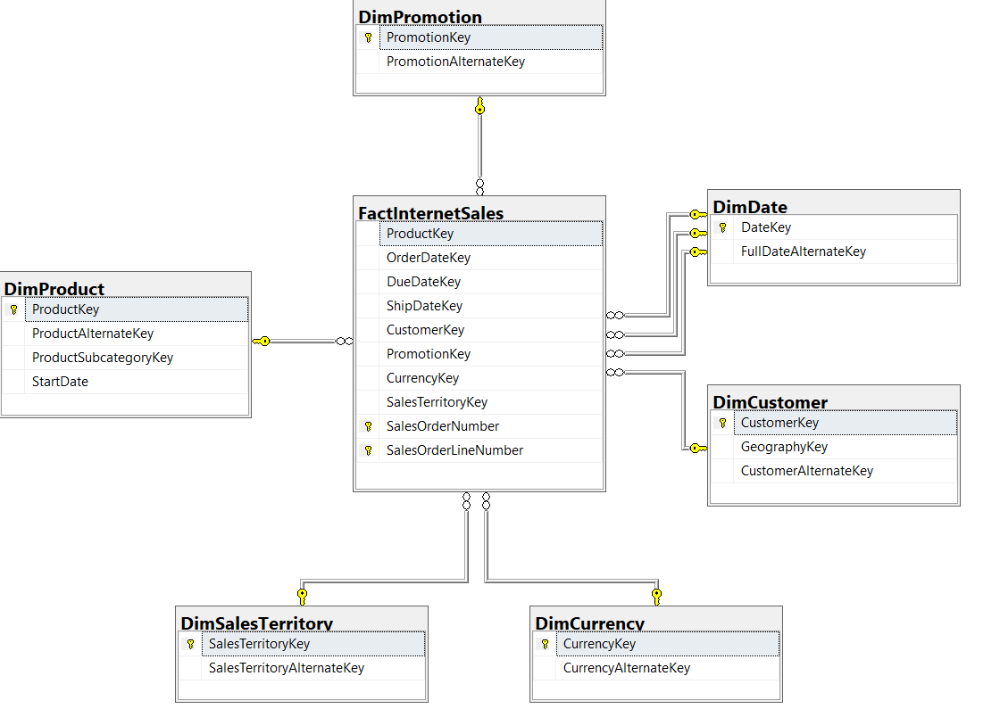
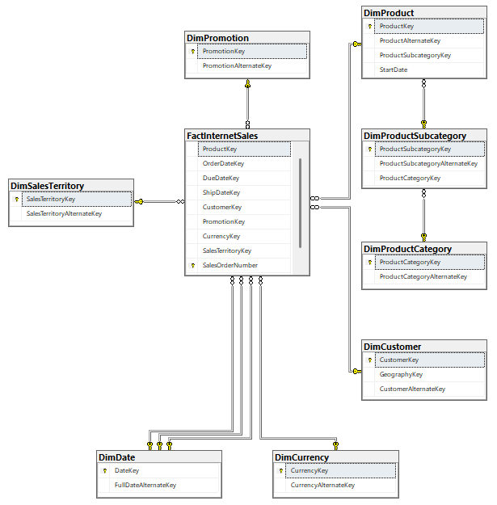

# Data warehousing, explained from zero

Notes from Week 3 of my SQL Server training (Days 15 to 21) at the Punjab Information Technology Board.
They are written for someone who knows basic SQL (`SELECT`, `JOIN`, `GROUP BY`) but has never seen a data warehouse.
Every number below comes from a query I actually ran. The query, its screenshot and a longer explanation are on the day's page of the [live site](https://noortayyababatool-spec.github.io/sql-syllabus/).

**Contents**

1. [The one-paragraph version](#1-the-one-paragraph-version)
2. [Words you need](#2-words-you-need)
3. [Why companies keep a second copy of their data (Day 15)](#3-why-companies-keep-a-second-copy-of-their-data-day-15)
4. [Facts, dimensions and grain (Day 16)](#4-facts-dimensions-and-grain-day-16)
5. [Designing a star from raw data: four questions (Day 17)](#5-designing-a-star-from-raw-data-four-questions-day-17)
6. [Every warehouse query has the same shape (Day 18)](#6-every-warehouse-query-has-the-same-shape-day-18)
7. [Star and snowflake schemas (Day 19)](#7-star-and-snowflake-schemas-day-19)
8. [Making a star survive real life: SCDs, the date dimension, surrogate keys (Day 20)](#8-making-a-star-survive-real-life-day-20)
9. [Two complete models: ride-sharing and a hospital (Days 17 to 21)](#9-two-complete-models)
10. [Mistakes I made, and what they taught me](#10-mistakes-i-made-and-what-they-taught-me)
11. [A checklist for designing a star](#11-a-checklist-for-designing-a-star)
12. [Test yourself (answers hidden)](#12-test-yourself)
13. [Files in this folder](#13-files-in-this-folder)

---

## 1. The one-paragraph version

A company's everyday database (the one the website and the sales app write to) is designed to record things quickly and safely, one at a time. That design makes it slow and awkward for questions like *"revenue by region by month for the last three years"*. So companies copy the data, every night for example, into a second database called a **data warehouse**, rebuilt in a shape made for answering questions. That shape has one central table of **events with numbers** (the *fact table*, for example every sale) surrounded by tables that **describe** those events (the *dimension tables*: customer, product, date, region). Drawn on paper it looks like a star, so it is called a **star schema**. Almost every report then becomes the same simple query: take the fact table, join the dimensions you need, group, and add up.

---

## 2. Words you need

| Word | Plain meaning | Example from AdventureWorksDW |
|---|---|---|
| **OLTP** (online transaction processing) | A database that *runs* the business: many small, fast writes | AdventureWorks2022: one row per order, updated live |
| **OLAP** (online analytical processing) | A database built for *analysing* the business: big reads, summing history | AdventureWorksDW2022, the warehouse |
| **Data warehouse** | A separate copy of the data, reshaped for reporting and loaded in batches | AdventureWorksDW2022 |
| **ETL** | Extract, Transform, Load: the job that copies and reshapes data into the warehouse | The SSIS package from Day 13 |
| **Fact table** | One row per business event, holding numbers and keys. Long and narrow | `FactInternetSales`: one row per product sold online |
| **Dimension table** | Describes the who / what / where / when of the events. Short and wide, mostly text | `DimCustomer`, `DimProduct`, `DimDate` |
| **Grain** | What exactly one row of the fact table means | "One product on one order line" |
| **Measure** | A number in the fact table that you add up or average | `SalesAmount`, `OrderQuantity` |
| **Attribute** | A descriptive column in a dimension that you filter or group by | `Color`, `CalendarYear`, `City` |
| **Natural key** | The ID from the source system | `ProductAlternateKey` = `FR-M94B-38` |
| **Surrogate key** | A plain integer ID the warehouse creates itself | `ProductKey` = 304 |
| **Degenerate dimension** | An ID kept in the fact table that has no table of its own | `SalesOrderNumber` |
| **Star schema** | Fact in the middle, each dimension one flat table joined straight to it | See [section 7](#7-star-and-snowflake-schemas-day-19) |
| **Snowflake schema** | Like a star, but some dimensions are split into chains of tables | `DimProduct` → `DimProductSubcategory` → `DimProductCategory` |
| **Conformed dimension** | One dimension shared by several fact tables, with the same meaning everywhere | `DimDate`, used by 8 fact tables |
| **SCD** (slowly changing dimension) | The rule for what happens when a described thing changes, e.g. a customer moves | Type 1 = overwrite, Type 2 = keep history |
| **Role-playing dimension** | One dimension used several times by the same fact, in different roles | `DimDate` as order date, due date and ship date |

---

## 3. Why companies keep a second copy of their data (Day 15)

The two sample databases hold the *same business* in two different shapes:

| | OLTP: AdventureWorks2022 | Warehouse: AdventureWorksDW2022 |
|---|---|---|
| Job | Record each sale, payment and change the moment it happens | Answer questions over history |
| Typical query | Touch a few rows by key: "insert order 75124" | Read and sum many rows: "revenue by territory by year" |
| Used by | Apps: website, sales app, scanner | Analysts, managers, Power BI |
| Writes | Small INSERT / UPDATE / DELETE all day | Loaded in batches (e.g. nightly); otherwise read-only |
| Shape | **Normalised**: each fact stored once, many narrow tables | **Denormalised**: descriptions copied into wide dimension rows |
| Number of tables | **72** | **31** (16 `Dim…`, 10 `Fact…`, 5 others) |

**What "normalised" means.** Each piece of information is stored in exactly one place. A country name lives only in `Person.CountryRegion`; everything else points at it by key. That is perfect for updates (change one row) and bad for reports. To print one customer's name and country in the OLTP database took **five joins across six tables**. The warehouse did those joins once, during loading, so the same question needs **one join**.

**Same data, different answers?** "Revenue by territory and year" gave different numbers in the two databases. Reconciling them showed:

- The OLTP query had summed *every* order (online and reseller) *including tax and freight*: 123.2 million.
- Restricting it to online orders and excluding tax and freight gave **29,358,677.2207**, *exactly* the warehouse total to four decimals.
- The per-year figures still differ because the sample warehouse's dates were **shifted about five months earlier** (29 Dec 2010 to 28 Jan 2014 instead of 31 May 2011 to 30 Jun 2014).

> **Lesson:** when two reports disagree, first check that they are asking exactly the same question (which orders count, is tax included?), then reconcile the totals.

**Why not just point Power BI at the OLTP database?** Every chart would run heavy multi-join queries against the same server that takes customer orders, slowing checkout and blocking writes; every report would re-implement the business rules (and some would get them wrong); and the OLTP database usually overwrites old values, so history such as last year's price is gone.

---

## 4. Facts, dimensions and grain (Day 16)

### Telling them apart

| | Fact table | Dimension table |
|---|---|---|
| Records | Events / measurements | Descriptions |
| Columns | Mostly integer keys + numbers | One key + mostly text |
| Rows | Many (FactInternetSales: 60,398) | Few (DimProduct: 606, DimSalesTerritory: 11) |
| Example columns | `ProductKey`, `CustomerKey`, `OrderDateKey`, `SalesAmount` | `EnglishProductName`, `Color`, `ListPrice` |

### Grain: decide it first, always

The grain is the precise meaning of one fact row. For `FactInternetSales` it is **one product on one sales order line**. You can *prove* a grain: if it is right, the columns that identify it are unique, so this returns nothing:

```sql
SELECT SalesOrderNumber, SalesOrderLineNumber, COUNT(*)
FROM FactInternetSales
GROUP BY SalesOrderNumber, SalesOrderLineNumber
HAVING COUNT(*) > 1;      -- 0 rows: the grain holds for all 60,398 rows
```

### Three kinds of measure

| Type | Can you SUM it? | Example | What I found |
|---|---|---|---|
| **Additive** | Across everything | `SalesAmount` | Sum by colour or by year always adds back to 29.36 million |
| **Semi-additive** | Across some dimensions, **not across time** | `UnitsBalance` (stock on hand) | Product 1 has 875 in stock every day; summing 1,281 daily rows gives 1,120,875 units that never existed |
| **Non-additive** | Never | `UnitPrice`, ratios, percentages | In reseller sales `SUM(UnitPrice)` = 27.0 million vs real revenue 80.5 million. Correct average price = revenue ÷ units = 375.27 |

> **Trap:** in `FactInternetSales`, `SUM(UnitPrice)` *happens* to equal revenue, because every online line has quantity 1. A query can be wrong and still give the right number on one table. Test it where the data varies.

### Two special kinds of fact table

- **A fact table with a target:** `FactSalesQuota`, one row per salesperson per quarter with `SalesAmountQuota`.
- **A factless fact table:** `FactSurveyResponse` has keys but **no number at all**. Each row says "on this date, this customer reported buying from this subcategory". You count rows.

---

## 5. Designing a star from raw data: four questions (Day 17)

Given tables you have never seen, ask in this order:

| # | Question | Gives you | Sales example |
|---|---|---|---|
| 1 | What business **event** is being measured? | The fact | An online sale |
| 2 | What is the **lowest level of detail** anyone would ever want? | The grain | One product on one order line |
| 3 | What **numbers** describe the event? | The measures (and whether each is additive) | Quantity (additive), unit price (non-additive) |
| 4 | What would people **filter or group by**? | The dimensions | Customer, product, territory, date |

> **A number is not always a measure.** A phone number, postcode or plate number is stored as digits, but adding them up means nothing. Test: *would `SUM` of this column ever mean anything?*

**Checking my answer against Microsoft's.** From the six OLTP sales tables I proposed the same grain (60,398 lines) and the same dimensions as `FactInternetSales`. Microsoft additionally has currency and promotion, which come from tables that were not in the exercise. Microsoft also **allocated** order-level tax and freight down to each line: tax adds back exactly (2,348,694.23), freight comes out 1.94 too high because of rounding.

**HR has two facts:** a pay change (`EmployeePayHistory`, 316 rows) and a department transfer (`EmployeeDepartmentHistory`, a *factless* fact). Hourly `Rate` is non-additive: Rob Walters's three rates sum to 62.19/hour, a rate he never had. AdventureWorksDW has no HR fact at all; `DimEmployee` exists only to say *who sold*, and it keeps only each employee's latest pay rate.

**Ride-sharing**, built for real in my practice database (`AWPractice`), is in [section 9](#9-two-complete-models).

---

## 6. Every warehouse query has the same shape (Day 18)

```sql
SELECT   <dimension attributes>, <AGG>(f.<measure>) AS <name>
FROM     <FactTable> f
JOIN     <DimTable> d1 ON f.<Dim1Key> = d1.<Dim1Key>     -- one join per dimension used
JOIN     <DimTable> d2 ON f.<Dim2Key> = d2.<Dim2Key>
WHERE    <dimension attribute> = <value>                  -- filter on dimensions
GROUP BY <the same dimension attributes>;
```

Example: revenue by country and year.

```sql
SELECT g.EnglishCountryRegionName AS Country, d.CalendarYear, SUM(f.SalesAmount) AS Revenue
FROM FactInternetSales f
JOIN DimCustomer  c ON c.CustomerKey  = f.CustomerKey
JOIN DimGeography g ON g.GeographyKey = c.GeographyKey
JOIN DimDate      d ON d.DateKey      = f.OrderDateKey
GROUP BY g.EnglishCountryRegionName, d.CalendarYear;
```

No `YEAR()` function, no business logic: the year is a ready-made column in `DimDate`.

**The one rule that catches people out: two fact tables.** To put internet and reseller revenue side by side, **aggregate each fact to the shared level first, then join the results**. Joining the two facts row to row multiplies them. (Worked example: [Day 21, Q12](https://noortayyababatool-spec.github.io/sql-syllabus/day21/).)

**The same thing in Power BI, with no SQL:** load the fact and dimensions → Power BI draws the relationships from the foreign keys (those *are* the joins) → drag a dimension attribute to Rows, another to Columns, a measure to Values. Every field you drag is either a dimension attribute or a measure: that is why warehouses are shaped as stars.

---

## 7. Star and snowflake schemas (Day 19)

**Star:** each dimension is one flat table joined directly to the fact. `DimProduct` would carry Subcategory and Category as columns.
**Snowflake:** dimensions are split into chains. `DimProduct` → `DimProductSubcategory` → `DimProductCategory`.



*The star: `FactInternetSales` in the middle, one line to each dimension. `DimDate` has three lines: order, due and ship date.*



*Add `DimProductSubcategory` and `DimProductCategory` and the star grows a branch: that branch is the snowflake.*

| | Star | Snowflake |
|---|---|---|
| Joins | One per dimension | One per level of each chain |
| Repeated text | Some ("Bikes" on every bike row) | None |
| For users / Power BI | Simple: every product attribute in one table | Harder: which table holds Category? |
| Use it when | Almost always (the default) | A dimension level is huge, or shared by several dimensions |

**AdventureWorksDW is a mix:** every fact is the centre of a star, and three areas are snowflaked: product, customer geography (`DimCustomer` → `DimGeography` → `DimSalesTerritory`) and employee territory.

**Findings worth knowing:**

- **A view does not remove joins.** I hid the product snowflake inside a view so queries needed one join. SQL Server still joined all four tables, and because the view used `LEFT JOIN`s the plan was about **57% more expensive** (cost 2.45 vs 1.55). A view saves typing, not work.
- **How much repetition would flattening cost?** 18,484 customers live in only 336 geographies: about 55 customers per city. Copying the city into each customer row repeats it ~55 times: a few hundred kilobytes. *Disk is cheap; joins are not.*
- **Conformed dimension:** eight fact tables point at the same `DimDate`, so "2013 Q4" means the same days in every report.

**Why Power BI's documentation says "prefer a star":** one table per subject with one relationship to the fact means filters flow simply, users find every attribute where they expect it, and the model is smaller and faster.

---

## 8. Making a star survive real life (Day 20)

A textbook star works on day one. These three ideas keep it working after a year of real data.

### 8.1 Slowly changing dimensions (SCD)

A rider, Ayesha, lived in Lahore and moved to Islamabad on 15 October. Her earlier rides were in Lahore. What should a report of *"revenue by rider city for 1 October"* show?

| | **Type 1: overwrite** | **Type 2: add a new row** |
|---|---|---|
| What you do | `UPDATE` her city | Close the old row (set an end date, `IsCurrent = 0`) and `INSERT` a new row with a **new surrogate key** |
| History | Lost: her Lahore rides now show Islamabad | Kept: old rides still point at the old row |
| Use for | Corrections (a misspelt name) | Real changes that reports must respect (a move, a price change) |

What the Type 2 dimension looks like after her move (real result, `AWPractice.DimRider`):

| RiderKey | RiderPhone | RiderName | RiderCity | EffectiveFrom | EffectiveTo | IsCurrent |
|---|---|---|---|---|---|---|
| 1 | 0300-1111111 | Ayesha | Lahore | 2026-01-01 | 2026-10-14 | 0 |
| 6 | 0300-1111111 | Ayesha | Islamabad | 2026-10-15 | NULL | 1 |
| 2 | 0321-2222222 | Bilal | Lahore | 2026-01-01 | NULL | 1 |
| 3 | 0333-3333333 | Sara | Karachi | 2026-01-01 | NULL | 1 |

The change itself is two statements, in one transaction:

```sql
SET XACT_ABORT ON;                 -- if anything fails, undo everything
BEGIN TRANSACTION;
UPDATE DimRider SET EffectiveTo = '2026-10-14', IsCurrent = 0       -- close the old row
WHERE RiderPhone = '0300-1111111' AND IsCurrent = 1;
INSERT INTO DimRider (RiderPhone, RiderName, RiderCity, EffectiveFrom)  -- open a new one
VALUES ('0300-1111111', 'Ayesha', 'Islamabad', '2026-10-15');
COMMIT;
```

When a new ride is loaded, the ETL finds the right version **by natural key and date**:

```sql
SELECT RiderKey FROM DimRider
WHERE RiderPhone = '0300-1111111'
  AND '2026-10-20' BETWEEN EffectiveFrom AND ISNULL(EffectiveTo, '9999-12-31');   -- returns 6
```

A ride on 1 October gets key 1 (Lahore); a ride on 20 October gets key 6 (Islamabad). Old reports never change.

**You choose the type per column, not per table.** Her city is Type 2; her name is Type 1 (correcting "Ayesha" to "Ayesha Khan" updates both of her rows).

**Type 2 in the real warehouse:** product `FR-M94B-38` has three rows (keys 304, 305, 306) for three list prices: 1,191.17 → 1,226.91 → 1,349.60. Its 289 reseller sales split 71 / 113 / 105 across the versions, each at the price in force when sold, with no date logic in the query. `DimProduct` has 606 rows for 504 products: the 102 extra rows are history, not duplicates.

### 8.2 The date dimension

One row per calendar day, with everything about the day pre-calculated:

| DateKey | FullDate | Year | Quarter | MonthName | DayName | IsWeekend | FiscalYear | FiscalQuarter |
|---|---|---|---|---|---|---|---|---|
| 20261001 | 2026-10-01 | 2026 | 4 | October | Thursday | 0 | 2027 | 2 |
| 20261003 | 2026-10-03 | 2026 | 4 | October | Saturday | 1 | 2027 | 2 |

Fact tables store only the integer `DateKey`. It saves you from:

1. Writing `YEAR()`, `DATENAME()` and fiscal-year `CASE` logic in every query, and getting it wrong in some.
2. Missing days: the table has every day, including days with no sales, so a report can show a zero.
3. Hard-coding company calendars: fiscal periods and holidays become columns you filter on.

My reusable build script is [`dimdate.sql`](dimdate.sql) (fiscal year starts in July, as in Pakistan).

**Why `20261030` and not a `DATE`?** Not for size (`DATE` is 3 bytes, `INT` is 4). It is readable, sorts in date order, joins like every other integer key, suits range partitioning, and can hold special rows such as `-1` = "unknown date".

### 8.3 Surrogate keys

The source system's ID can change, be reused, clash between systems, or be a long string. Once a dimension keeps Type 2 history, **the natural key is no longer unique**. Proof from the warehouse:

| Joined on | Lines | Revenue for FR-M94B-38 |
|---|---|---|
| Surrogate key (`ProductKey`) | 289 | 501,788.20 |
| Natural key (`ProductAlternateKey`) | 867 | 1,505,364.59, three times too much |

**Rule:** fact tables store surrogate keys only. The natural key lives in the dimension, for lookups during loading.

---

## 9. Two complete models

### Ride-sharing (built in AWPractice, Days 17, 19, 20)

Raw data: one table of rides with rider, driver, vehicle, zones, times, distance, fare, tip, rating, payment and promo.

- **Fact:** a completed ride. **Grain:** one row per ride. `RideID` stays as a degenerate dimension.
- **Measures:** FareAmount, TipAmount, DistanceKm, DurationMin (additive); Rating (non-additive: average it). Ride count = `COUNT(*)`.
- **Dimensions:** Rider, Driver, Vehicle, Zone (used twice: pickup and dropoff), Date, and a small "junk" dimension combining payment method and promo code.

```
                 DimRideDate / DimDate                 DimRider  (TYPE 2 on RiderCity)
                          \                           /
  DimZone (pickup)  ---  FactRide  -------------------  DimDriver
  DimZone (dropoff) ---  RideID, DateKey, PickupHour
                         FareAmount, TipAmount, DistanceKm, DurationMin, Rating
                          /                           \
               DimPayment (junk)                     DimVehicle
```

| Dimension / column | SCD type | Why |
|---|---|---|
| Rider city | **2** | Where riders lived when they rode matters for city reports |
| Rider name, driver name, vehicle type, zone name | 1 | Changes are corrections |
| Zone's city, payment combinations, dates | 0 | Never change |

Star or snowflake? Built both ways on Day 19. "Fare by city by month" takes **2 joins on the star and 3 on the snowflake**, same answer (Lahore 1,330, Karachi 700). With only 2 cities and 3 vehicle types, the star wins.

### Hospital visits (Day 21)

Raw columns: VisitID, PatientID, PatientName, PatientDOB, DoctorID, DoctorName, Department, VisitDate, VisitTime, DiagnosisCode, DiagnosisDescription, ProcedureCode, DurationMinutes, BillAmount, InsuranceProvider, PaidAmount.

- **Fact:** a procedure performed in a visit, `FactVisitProcedure`.
- **Grain:** one procedure in one visit (VisitID + ProcedureCode), because a visit can have several procedures.
- **Measures:** DurationMinutes, BillAmount, PaidAmount (additive). Outstanding = Bill − Paid. *Check first whether BillAmount is per procedure or per visit; if it is repeated on every procedure row, summing it double-counts.*
- **Dimensions:** Patient, Doctor (with Department), Date (+ visit hour in the fact), Diagnosis, Procedure, Insurance.
- **Type 2:** `DimDoctor`, because a doctor can move department and visits must stay with the department of the time.

```
                       DimDate (shared)
                             |
   DimPatient -------- FactVisitProcedure -------- DimDoctor  (TYPE 2: Department)
                        /        |        \
              DimDiagnosis  DimProcedure  DimInsurance
```
*(Every dimension joins straight to the fact; none of them point at each other.)*

The model was created as real tables with foreign keys (schema `hosp` in AWPractice) so SQL Server checks the design: see [day21.sql](sql/day21.sql).

---

## 10. Mistakes I made, and what they taught me

| What happened | Lesson |
|---|---|
| My first Type 2 change failed: the Day 17 table had a `UNIQUE` constraint on `RiderPhone` | Making a dimension Type 2 changes its rules. Replace "one row per natural key" with **"one current row per natural key"** (a filtered unique index `WHERE IsCurrent = 1`) |
| In that failed attempt the `UPDATE` ran, the `INSERT` failed, and `COMMIT` saved the half-change: Ayesha had no current row | A transaction alone is not enough: add `SET XACT_ABORT ON` (or TRY/CATCH) so any error rolls everything back |
| The syllabus's `CREATE TABLE DimRider` failed: the table already existed and a fact pointed at it | Real warehouses rarely start fresh: `ALTER TABLE` the existing dimension instead of dropping it |
| `SUM(UnitPrice)` gave the "right" revenue on internet sales | It was a coincidence (quantity is always 1). Test logic where the data varies |
| OLTP and warehouse revenue by year disagreed | Same total, shifted dates. Reconcile totals before trusting per-period figures |
| I flattened the snowflake with a view and expected faster queries | The server still joins everything; only a physically flat table removes joins |
| Two-fact report (internet + reseller): an inner join lost Q1 2014, when resellers sold nothing | Aggregate each fact first, then `FULL JOIN` on the shared dimension |
| `DimProduct` has EndDates *before* StartDates for 200 rows | Use the current flag (`Status = 'Current'` / `EndDate IS NULL`), not date order |

---

## 11. A checklist for designing a star

1. Name the **business event**: that is the fact.
2. Write the **grain** as one sentence ("one row per …") and prove it unique on the source data.
3. List the **measures**; mark each additive, semi-additive or non-additive.
4. List what people **filter and group by**: those are the dimensions. Fold tiny ones together (junk dimension) and keep IDs with no attributes in the fact (degenerate dimension).
5. Give every dimension an **integer surrogate key**; keep the natural key as a column.
6. Decide **Type 1 or Type 2 per column**. For Type 2 add `EffectiveFrom`, `EffectiveTo`, `IsCurrent`, and make the natural key unique only among current rows.
7. Use one shared **date dimension** with an integer `yyyymmdd` key.
8. Prefer a **star**; snowflake only a level that is huge or shared.
9. Write the three or four questions the business will ask and **run them** against the design before calling it done.

---

## 12. Test yourself

<details><summary><b>1. What is the difference between OLTP and OLAP?</b></summary>

OLTP runs the business: many small, fast, safe writes into normalised tables (AdventureWorks2022, 72 tables). OLAP analyses it: big reads that sum history from a denormalised warehouse of facts and dimensions (AdventureWorksDW2022, 31 tables), loaded in batches.
</details>

<details><summary><b>2. Define fact table, dimension table and grain.</b></summary>

A fact table holds one row per business event with numbers and keys (FactInternetSales). A dimension table describes the who/what/where/when with text attributes (DimProduct). The grain is what exactly one fact row means ("one product on one order line"), and it is decided first.
</details>

<details><summary><b>3. Give an additive, a semi-additive and a non-additive measure.</b></summary>

Additive: SalesAmount. Semi-additive: UnitsBalance (stock on hand: sum across products, not across days). Non-additive: UnitPrice or any ratio: recalculate from additive totals.
</details>

<details><summary><b>4. Star vs snowflake, and which is AdventureWorksDW?</b></summary>

Star: each dimension one flat table, one join from the fact. Snowflake: dimensions split into chains. AdventureWorksDW is a mix: stars around each fact, snowflaked product, geography and territory.
</details>

<details><summary><b>5. Why does a fact table store only surrogate keys?</b></summary>

With Type 2 history the natural key matches several rows, so joining on it multiplies facts (three times the revenue for FR-M94B-38). Natural keys can also change, be reused or clash between systems.
</details>

<details><summary><b>6. SCD Type 1 vs Type 2, with an example.</b></summary>

Type 1 overwrites (fixing a misspelt name). Type 2 closes the old row and adds a new one with a new key (Ayesha's move: old rides stay in Lahore under key 1, new rides use key 6 in Islamabad).
</details>

<details><summary><b>7. What does a date dimension save you from?</b></summary>

Date functions and fiscal logic in every query; missing days in reports; hard-coded holidays and company calendars.
</details>

<details><summary><b>8. What is a conformed dimension?</b></summary>

One dimension shared by several facts with the same keys and meaning, e.g. DimDate used by eight facts, so internet and reseller revenue can be compared by quarter.
</details>

<details><summary><b>9. Name the three snowflake chains in AdventureWorksDW.</b></summary>

DimProduct → DimProductSubcategory → DimProductCategory; DimCustomer → DimGeography (→ DimSalesTerritory); DimEmployee → DimSalesTerritory.
</details>

<details><summary><b>10. When is snowflaking worth it?</b></summary>

When a dimension level is very large, or is shared by several dimensions and must be maintained in one place.
</details>

---

## 13. Files in this folder

| File | What it is |
|---|---|
| [`notes.md`](notes.md) | This guide |
| [`dimdate.sql`](dimdate.sql) | Reusable script that builds a date dimension for any date range |
| [`sql/day15.sql`](sql/day15.sql) … [`sql/day21.sql`](sql/day21.sql) | Every query from each day, in order, with a one-line takeaway per step. Run one step at a time in SSMS |
| [`images/`](images/) | The SSMS database diagrams from Day 19 |

**To try it yourself:** install SQL Server Express and SSMS, restore Microsoft's free sample backups `AdventureWorks2022.bak` and `AdventureWorksDW2022.bak` (from the [sql-server-samples](https://github.com/microsoft/sql-server-samples/releases) releases on GitHub), create an empty database called `AWPractice`, then run the day files in order.
