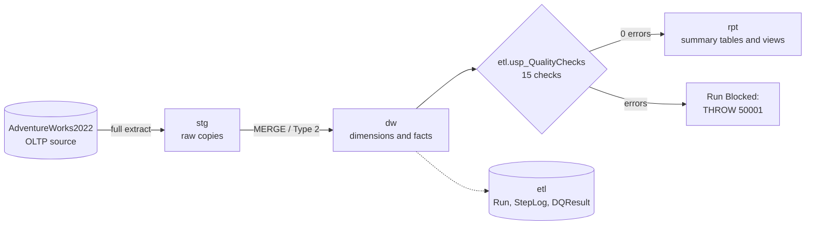
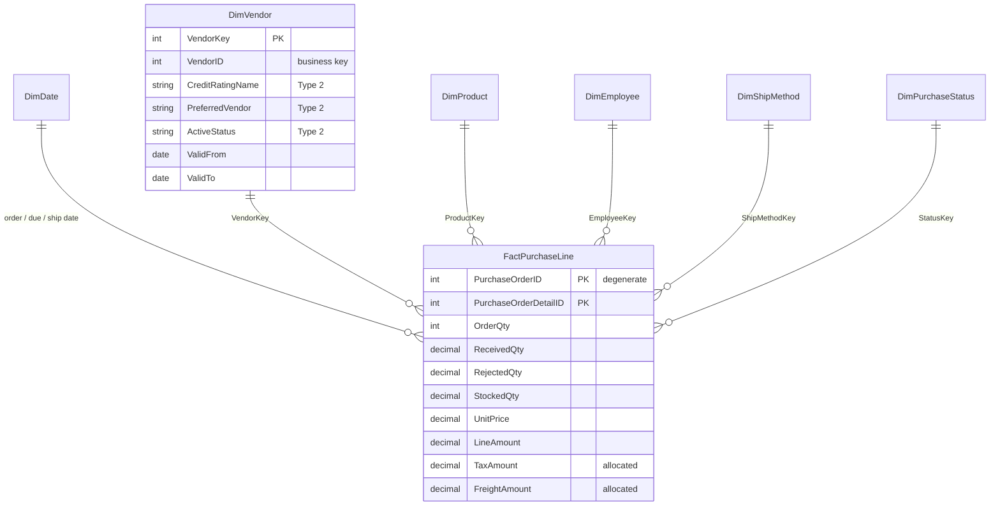
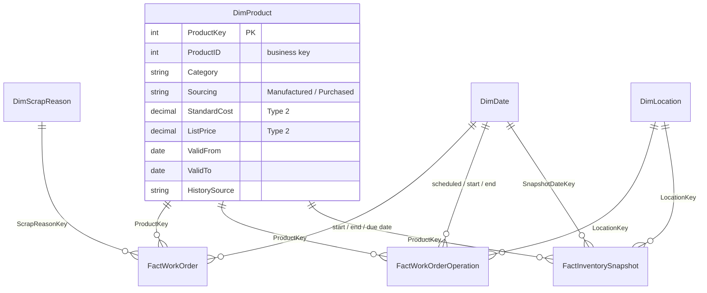

# Mini project: AWSupplyDW, a supply-chain data warehouse

The Week 8 mini project of my Data Engineering internship at PITB: design a complete data warehouse, load sample transactional data into it, answer ten analytical questions, build summary tables and views, and document it.

The source is the **purchasing and manufacturing** side of AdventureWorks2022, which none of the earlier weeks used. Weeks 3 and 4 modelled sales; this project models what the company buys, what it builds and what it holds in stock. It reuses the techniques of Weeks 3 and 4: Type 2 history, Unknown members, a re-runnable ELT load with a run log, and data quality checks with a gate.

Everything is plain T-SQL on SQL Server 2022 Express. One procedure call, `EXEC etl.usp_RunAll`, rebuilds the warehouse from the source in about five seconds.

## Contents

1. [Business questions](#1-business-questions)
2. [Source data](#2-source-data)
3. [Architecture](#3-architecture)
4. [Dimensional model](#4-dimensional-model)
5. [Design decisions](#5-design-decisions)
6. [The load](#6-the-load)
7. [Data quality](#7-data-quality)
8. [Summary tables and views](#8-summary-tables-and-views)
9. [Ten analytical queries](#9-ten-analytical-queries)
10. [Tests](#10-tests)
11. [Findings](#11-findings)
12. [How to run it](#12-how-to-run-it)

## 1. Business questions

| Area | Question |
|---|---|
| Purchasing | How much do we spend per month, and how does it compare with last year? |
| Purchasing | Which vendors take most of the money? |
| Purchasing | Which vendors deliver the most rejected goods? Does a vendor's credit rating predict quality? |
| Purchasing | Where do vendors charge very different prices for the same part? |
| Purchasing | How is the buying work spread across the buyers? |
| Manufacturing | How much is scrapped, why, and what does it cost? |
| Manufacturing | Which products are finished late? Which work centres carry the load? |
| Inventory | What is the stock worth, and what needs reordering? |

## 2. Source data

AdventureWorks2022 on `localhost\SQLEXPRESS`, read across databases. About 155,000 source rows:

| Source table | Rows | Used for |
|---|---:|---|
| Purchasing.PurchaseOrderHeader / Detail | 4,012 / 8,845 | Purchase facts, April 2011 to September 2014 |
| Purchasing.Vendor (+ address) | 104 | Vendor dimension |
| Purchasing.ShipMethod | 5 | Ship method dimension |
| HumanResources.Employee (+ Person, department) | 290 | Buyer dimension |
| Production.Product (+ subcategory, category) | 504 | Product dimension |
| Production.ProductCostHistory / ProductListPriceHistory | 395 / 395 | Product price versions |
| Production.WorkOrder | 72,591 | Work order facts, June 2011 to June 2014 |
| Production.WorkOrderRouting | 67,131 | Operation facts |
| Production.Location / ScrapReason | 14 / 16 | Work centre and scrap reason dimensions |
| Production.ProductInventory | 1,069 | Inventory snapshot |

What profiling found before any design, and what it changed:

- **Every product is either made or bought, never both** (238 made, 265 bought). One product dimension serves both processes, with a `Sourcing` column.
- **Delivery dates are synthetic.** Every completed or pending order ships exactly 9 days after ordering and is due after 14, so an on-time delivery KPI would always say 100%. Vendor performance is measured by **rejections and short deliveries** instead.
- **"Rejected" orders were rejected on arrival.** 46,746 units were received on them and 1 was stocked. They are kept as facts but do not count as spend.
- **Planned cost equals actual cost on every one of the 67,131 operations.** The source does not really record actual cost, so no cost-variance report is offered; a quality check records this.
- **Most purchased parts have a standard cost of 0.** Valuing stock at standard cost would value 228,992 units of purchased parts at nothing.

## 3. Architecture



| Schema | Holds |
|---|---|
| `stg` | Plain copies of the source columns, emptied and refilled on every run |
| `etl` | `Run` (one row per run), `StepLog` (one row per step: rows, seconds, error), `DQResult` (one row per check per run), and the load procedures |
| `dw` | 8 dimensions and 4 facts |
| `rpt` | 2 summary tables, rebuilt only when the quality gate passes, and 4 views |

**ELT, full extract.** The source is copied as it is and transformed inside SQL Server. The whole source is about 155,000 rows and copies in under half a second, so a watermark-based incremental extract (Day 22) would add complexity without saving time. The loads into `dw` are incremental: they change only what differs.

## 4. Dimensional model

### Bus matrix

| Fact (grain) | Date | Product | Vendor | Employee | Ship method | Status | Location | Scrap reason |
|---|:-:|:-:|:-:|:-:|:-:|:-:|:-:|:-:|
| FactPurchaseLine (one purchase order line) | order, due, ship | ✓ | ✓ | ✓ | ✓ | ✓ | | |
| FactWorkOrder (one work order) | start, end, due | ✓ | | | | | | ✓ |
| FactWorkOrderOperation (one operation of a work order) | scheduled, start, end | ✓ | | | | | ✓ | |
| FactInventorySnapshot (product x location on a date) | snapshot | ✓ | | | | | ✓ | |

`DimDate` and `DimProduct` are **conformed**: every fact uses the same tables, so purchasing, production and stock can be compared by product or by month. `DimDate` plays several roles (order, due, ship, start and end date).

### Purchasing star



### Manufacturing and inventory stars



### Tables after the load

| Table | Rows | Type | Notes |
|---|---:|---|---|
| dw.DimDate | 1,462 | Generated | 2011 to 2014 plus Unknown; fiscal year starts 1 July |
| dw.DimProduct | 607 | Type 2 | 504 products, 606 versions, plus Unknown |
| dw.DimVendor | 105 | Type 2 | 104 vendors plus Unknown |
| dw.DimEmployee | 291 | Type 1 | |
| dw.DimShipMethod, DimLocation, DimScrapReason, DimPurchaseStatus | 6, 15, 18, 5 | Type 1 / fixed | Scrap reason 0 = "Not scrapped" |
| dw.FactPurchaseLine | 8,845 | Transaction | 63,791,994.84 ordered |
| dw.FactWorkOrder | 72,591 | Transaction | |
| dw.FactWorkOrderOperation | 67,131 | Transaction | |
| dw.FactInventorySnapshot | 1,069 | Periodic snapshot | 12 August 2014 |
| rpt.PurchaseMonthly | 1,466 | Summary | month x vendor x category |
| rpt.ProductionMonthly | 470 | Summary | month x subcategory |

## 5. Design decisions

| Decision | Choice | Why |
|---|---|---|
| Fact grain | The lowest available: order line, work order, operation | Any total can be built from the detail; detail cannot be rebuilt from totals |
| Two manufacturing facts | Work order **and** operation | Scrap and lateness belong to the work order; hours and work centres belong to the operation. One table at operation grain would repeat the scrap of a work order on every operation and double-count it |
| Tax and freight | Allocated to lines by line amount; the largest line takes the rounding remainder | They are recorded per order. Allocation lets them be summed by product or vendor, and the remainder rule makes the lines add back up to the order exactly (checked) |
| Product history | **Type 2, built from the source's own price history** | Day 25 found that giving every first version "valid since 1900" with today's price puts today's price on old facts. Here a new version starts on every date the cost or list price changed in `ProductCostHistory` / `ProductListPriceHistory`. The first version is extended back to 1900 with the **earliest recorded** price, the best estimate for older facts. 293 products have history (77 of them changed price); 211 have none and get one version |
| Vendor history | Type 2 on credit rating, preferred status and active status; Type 1 on name and address | A rating change should not rewrite which rating a vendor had when an order was placed. The source keeps no vendor history, so first versions start in 1900; this is stated, not hidden |
| Lookups by date | A fact joins the version valid on its order or start date: `ValidFrom <= date AND date < ValidTo` | ValidTo is exclusive, so a date falls into exactly one version (checked) |
| Unknown members | Key -1 in every dimension | An inner join to a missing dimension row would lose the fact silently (Day 24) |
| "Not scrapped" | Its own member, key 0, not Unknown | 71,862 work orders scrapped nothing. That is a known value, not missing data |
| Rejected orders | Kept, with `CountsAsSpend = 0` on the status | The goods arrived and were returned: they matter for vendor quality but were not paid for |
| Inventory value | Standard cost, else the last price paid, else 0 with a warning; `CostBasis` records which | Purchased parts have no standard cost; without this, 8.44 million of stock would be valued at 0 |
| Inventory snapshot | Dated with the source's last inventory change; a re-run replaces that date | The source keeps only current stock. Quantity is **semi-additive**: add it across products and locations, never across dates |
| Fact loads | MERGE with an `EXCEPT` change test, including `WHEN NOT MATCHED BY SOURCE THEN DELETE` | Purchase lines change after they are placed (goods received, status moves). A re-run with no change updates nothing |
| Summary tables | Rebuilt in one transaction, only after the quality gate passes | A report never reads a half-built or failed load |

## 6. The load

`etl.usp_RunAll` runs every step in order, inside `TRY...CATCH`:

| Step | Procedure | Run 1 rows | Re-run rows |
|---|---|---:|---:|
| Extract | etl.usp_Extract | 155,371 | 155,371 |
| Date dimension | etl.usp_LoadDimDate | 1,461 | 0 |
| Type 1 dimensions | etl.usp_LoadSmallDimensions | 325 | 0 |
| Vendor (Type 2) | etl.usp_LoadDimVendor | 104 | 0 |
| Product (Type 2) | etl.usp_LoadDimProduct | 606 | 0 |
| Purchase lines | etl.usp_LoadFactPurchaseLine | 8,845 | 0 |
| Work orders | etl.usp_LoadFactWorkOrder | 72,591 | 0 |
| Operations | etl.usp_LoadFactWorkOrderOperation | 67,131 | 0 |
| Inventory snapshot | etl.usp_LoadFactInventorySnapshot | 1,069 | 1,069 (replaced) |
| Quality checks | etl.usp_QualityChecks | 15 checks | 15 checks |
| Publish | etl.usp_BuildSummaries | 1,936 | 1,936 |

Every step writes a row to `etl.StepLog` with its row count and duration. If a step fails, the `CATCH` block rolls back any open transaction, marks that step and the run `Failed` with the procedure name, line and message, and re-throws the error so a scheduler such as SQL Server Agent marks the job failed. The Type 2 loads use `SET XACT_ABORT ON`, so a failure can never close a version without adding its replacement (the Day 20 lesson).

## 7. Data quality

15 checks, recorded in `etl.DQResult` for every run. **Error** checks block publishing; **Warning** checks are published and go to a person.

| # | Check | Category | Severity | Run 1 |
|---|---|---|---|---|
| 1 | Purchase lines: staging = fact | Completeness | Error | Pass |
| 2 | Purchase amount: staging = fact | Completeness | Error | Pass |
| 3 | Tax and freight allocation adds up per order | Completeness | Error | Pass |
| 4 | Work orders and operations: staging = fact | Completeness | Error | Pass |
| 5 | Inventory units: staging = snapshot | Completeness | Error | Pass |
| 6 | Exactly one current version per product and vendor | Uniqueness | Error | Pass |
| 7 | Type 2 versions touch, no gaps or overlaps | Consistency | Error | Pass |
| 8 | Current product version has the source prices | Consistency | Error | Pass |
| 9 | Fact rows on an Unknown member | Consistency | Warning | Pass |
| 10 | Purchase quantities and amounts consistent (received = rejected + stocked) | Validity | Error | Pass |
| 11 | Work order quantities, dates and scrap reason consistent | Validity | Error | Pass |
| 12 | Purchase line due before it was ordered | Validity | Warning | **7 lines** |
| 13 | Stock with no cost to value it | Validity | Warning | **49 rows** |
| 14 | More received than ordered | Plausibility | Warning | Pass |
| 15 | Actual operation cost ever differs from plan | Plausibility | Warning | **Never** |

Result: **0 errors, 3 warnings; summaries published.** The three warnings are real properties of the source:

- **Due before ordered:** order 4003 is due on 3 December 2013 but was placed on 14 May 2014; order 4006's six lines are due a week before it was placed. Both are "Approved" orders, the only status whose dates do not follow the 9/14-day pattern.
- **No cost:** 18 manufactured subassemblies (21,816 units, 49 product-location rows) have neither a standard cost nor a purchase price.
- **Actual = planned cost:** cost variance cannot be reported from this source.

## 8. Summary tables and views

| Object | Kind | Grain / content | Used by |
|---|---|---|---|
| rpt.vPurchaseLine | View | Purchase line with every dimension name, plus total cost | Power BI / Excel |
| rpt.vVendorScorecard | View | One row per vendor: orders, spend, units received and rejected, reject %, short-delivery % | Q3 |
| rpt.vWorkCentreMonthly | View | Month x work centre: operations, hours, cost, late % | |
| rpt.vInventoryPosition | View | Product on the latest snapshot: units, value, cost basis, stock status against safety stock and reorder point | Q10 |
| rpt.PurchaseMonthly | Table | Month x vendor x category: orders, lines, units, rejected, spend, freight | |
| rpt.ProductionMonthly | Table | Month x subcategory: work orders, units, scrap %, scrap cost, late orders, days to build | |

Views are always current and cost nothing to store. The two summary tables are pre-computed, so dashboards read a few hundred rows instead of scanning the facts. Each row carries the `RunID` that built it.

## 9. Ten analytical queries

All in [sql/08_queries.sql](sql/08_queries.sql). "Spend" excludes rejected orders.

| # | Question | Technique | Answer |
|---|---|---|---|
| Q1 | Monthly spend, year to date, and growth on the same month last year | Months from DimDate (LEFT JOIN), running SUM, LAG(12) | Spend was at most 0.8 million a month (and nothing at all in 11 of those months) until July 2013, then 1.7 to 6.7 million a month from August 2013 to July 2014. Months with no orders exist, so the months must come from the date dimension: on fact rows alone, LAG(12) compared February 2013 with April 2011 |
| Q2 | Top vendors and cumulative share of spend | RANK, SUM OVER, running total | No strong Pareto: the top vendor (Superior Bicycles) takes 7.0%, the top 15 of 86 take 57.7% |
| Q3 | Worst quality vendors (at least 1,000 units) | rpt view, ranking | Rejection rates cluster around 5 to 5.5% for the worst ten; Anderson's Custom Bikes is highest at 5.48% |
| Q4 | Does credit rating predict quality? | GROUP BY on Type 2 attributes | No: the one "Below average" vendor rejects 2.34%, less than "Superior" preferred vendors (3.18%) |
| Q5 | Price spread between vendors for the same part | Window MIN/MAX/ROW_NUMBER per product | Touring Rim costs 26.60 from Anderson's Custom Bikes and 39.20 elsewhere (47% spread); lock washers differ by 23 to 30% |
| Q6 | Top three buyers per fiscal year and their share | RANK in a CTE, share of year | Work is spread evenly: from FY2014 no buyer has more than 11.6% |
| Q7 | Scrap rate, top reason and scrap cost per category | Two CTEs, CROSS APPLY TOP 1 | Scrap is low (0.16 to 0.25%) and spread evenly over reasons; it cost 351,542 in total |
| Q8 | Late work orders by subcategory and fiscal year | Conditional aggregation pivot | About half of wheels, handlebars and bikes finish late, every year; frames almost never. Components and parts went from 6.3% late to 14.5% |
| Q9 | Work centre hours and share per quarter (2013) | SUM of SUM OVER (PARTITION BY quarter) | Subassembly and Final Assembly carry about 70% of the hours. Cost per hour equals each work centre's cost rate exactly, another sign that "actual" cost is computed, not recorded |
| Q10 | Stock value by category and sourcing, products to reorder | rpt view | 28.5 million in stock: bikes 51%, purchased parts 30% (valued at last price paid); 69 products are below their reorder point, 55 of them purchased parts |

## 10. Tests

[sql/09_tests.sql](sql/09_tests.sql). Tests 2 to 4 run inside a transaction and end with `ROLLBACK`.

| Test | Result |
|---|---|
| 1. Run again with no source change | Every dimension and fact step reports 0 rows changed |
| 2. Raise product 776's cost by 10% and lower vendor 1492's rating | Each gets a second version starting today; the old version is closed on the same date |
| 3. Add 100 to one purchase line in the fact | Two Error checks fail ("Purchase amount: staging = fact", "Purchase quantities and amounts consistent"); the gate would block publishing |
| 4. A purchase line from a vendor that is not in the warehouse | Loaded on the Unknown vendor (key -1), with its tax and freight; nothing lost |

## 11. Findings

- **Ordering spend grew about tenfold in August 2013** and stayed there until July 2014; the source then stops.
- **Credit rating does not predict delivery quality** in this data (Q4).
- **Vendors charge up to 47% more than each other for the same part** (Q5): the clearest saving available.
- **Half of all wheels, handlebars and bikes are finished after their due date** in every year (Q8).
- **Purchased raw parts are 30% of the stock value**, invisible at standard cost (Q10).
- **The source's "actual cost" and delivery dates are generated, not recorded**: actual cost always equals plan, cost per hour always equals the cost rate, and every normal order ships after exactly 9 days. A warehouse can only report what the source measures; the quality checks make such limits visible instead of letting them look like perfect performance.

## 12. How to run it

Needs SQL Server 2019 or later with AdventureWorks2022 restored on the same instance. Run in SSMS, or with sqlcmd:

```
sqlcmd -S .\SQLEXPRESS -E -C -i 01_setup.sql      (drops and recreates AWSupplyDW)
sqlcmd -S .\SQLEXPRESS -E -C -i 02_staging.sql
sqlcmd -S .\SQLEXPRESS -E -C -i 03_warehouse.sql
sqlcmd -S .\SQLEXPRESS -E -C -i 04_load.sql
sqlcmd -S .\SQLEXPRESS -E -C -i 05_quality.sql
sqlcmd -S .\SQLEXPRESS -E -C -i 06_summary.sql
sqlcmd -S .\SQLEXPRESS -E -C -i 07_run.sql
sqlcmd -S .\SQLEXPRESS -E -C -d AWSupplyDW -Q "EXEC etl.usp_RunAll"
sqlcmd -S .\SQLEXPRESS -E -C -i 08_queries.sql
sqlcmd -S .\SQLEXPRESS -E -C -i 09_tests.sql
```

Then check the last run:

```sql
SELECT * FROM AWSupplyDW.etl.Run ORDER BY RunID DESC;
SELECT * FROM AWSupplyDW.etl.StepLog WHERE RunID = (SELECT MAX(RunID) FROM AWSupplyDW.etl.Run);
SELECT * FROM AWSupplyDW.etl.DQResult WHERE RunID = (SELECT MAX(RunID) FROM AWSupplyDW.etl.Run);
```

| File | Contents |
|---|---|
| [01_setup.sql](sql/01_setup.sql) | Database, schemas, run / step / quality tables, logging procedures |
| [02_staging.sql](sql/02_staging.sql) | Staging tables and the extract procedure |
| [03_warehouse.sql](sql/03_warehouse.sql) | Dimensions, facts, keys, Unknown members |
| [04_load.sql](sql/04_load.sql) | One load procedure per dimension or fact |
| [05_quality.sql](sql/05_quality.sql) | The 15 quality checks |
| [06_summary.sql](sql/06_summary.sql) | rpt views, summary tables and the publish procedure |
| [07_run.sql](sql/07_run.sql) | `etl.usp_RunAll`: the whole load with logging and the gate |
| [08_queries.sql](sql/08_queries.sql) | The ten analytical queries |
| [09_tests.sql](sql/09_tests.sql) | Re-run, Type 2, planted error and Unknown member tests |
